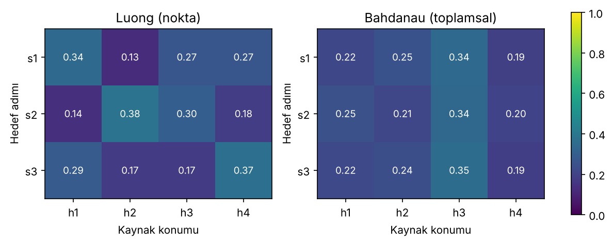

# 01 – Seq2seq yapısı ve dikkat mekanizmasının ortaya çıkışı

Kodlayıcı-kod çözücü yapısı, sabit uzunluklu bağlam vektörünün darboğazı, toplamsal (Bahdanau) ve çarpımsal (Luong) dikkat ve hizalama matrislerinin yorumlanması.

```bash
python dikkat_hizalama.py
```

Çıktılar: terminalde adım adım hesap, `figures/darbogaz.png`, `figures/hizalama_matrisi.png`.

## 1. Fikir

Seq2seq modelinde kodlayıcı kaynak cümleyi okur, kod çözücü hedef cümleyi üretir. İlk modellerde (Sutskever vd., 2014) kodlayıcının **son gizli durumu** tek bir sabit vektör olarak kod çözücüye verilir:

```
c = h_T            (kaynak ne kadar uzun olursa olsun, aynı boyut)
```

Bahdanau vd. (2015) bu vektörü her kod çözücü adımı için yeniden hesaplamayı önerdi:

```
c_i = Σ_j α_ij h_j        α_ij = softmax_j( e_ij )
```

Kod çözücü, hedef kelimeyi üretirken kaynağın hangi konumlarına bakacağını kendisi seçer.

## 2. Darboğaz deneyi

`darbogaz_deneyi()` basit bir tanh RNN kodlayıcı kurar (spektral yarıçap 0.9). Girdi dizisinin yalnızca **ilk elemanı** bozulur; kodlayıcının son durumunun ne kadar değiştiği ölçülür (30 rastgele ağırlık kümesi üzerinden ortalama):

| Dizi uzunluğu T | ‖h_T(x) − h_T(x′)‖ |
|---:|---:|
| 2 | 1.093272 |
| 5 | 0.087747 |
| 10 | 0.001066 |
| 20 | 0.000000 |
| 40 | 0.000000 |
| 80 | 0.000000 |

Yani T = 20'den sonra ilk kelimenin son duruma etkisi pratikte sıfır. Şekil: `figures/darbogaz.png`.

> **Sınırlama.** Bu deney sade bir tanh RNN ile yapıldı. LSTM/GRU kapıları bilgiyi daha uzun taşır, ancak tek bir sabit vektöre sıkıştırma sorunu yine vardır; Bahdanau vd.'nin çözümü bu darboğazı doğrudan kaldırır. Deney "darboğaz var" demek için bir örnektir, LSTM için bir ölçüm değildir.

## 3. Dikkat skorları – el hesabı

Kodlayıcı durumları (4 kaynak kelime, 3 boyut):

```
h1 = [1, 0, 0.5]   h2 = [0, 1, 0.5]   h3 = [1, 1, 0]   h4 = [0.5, 0, 1]
```

Kod çözücü durumu `s1 = [1, 0, 0.5]`.

### Luong (çarpımsal, nokta): e_j = s · h_j

```
e1 = 1·1   + 0·0 + 0.5·0.5 = 1.25
e2 = 1·0   + 0·1 + 0.5·0.5 = 0.25
e3 = 1·1   + 0·1 + 0.5·0   = 1.00
e4 = 1·0.5 + 0·0 + 0.5·1   = 1.00
```

Softmax: `exp(1.25)=3.4903, exp(0.25)=1.2840, exp(1)=2.7183`, toplam `10.2109`

```
α = [0.3418, 0.1258, 0.2662, 0.2662]
c = Σ α_j h_j = [0.7411, 0.3920, 0.5000]
```

Karşılaştırma için sabit bağlam vektörü `c_sabit = h4 = [0.5, 0, 1]`.

### Luong (genel): e_j = sᵀ W h_j  (W = 0.5·I)
`e = [0.625, 0.125, 0.5, 0.5]` → `α = [0.2966, 0.1799, 0.2618, 0.2618]`

### Bahdanau (toplamsal): e_j = vᵀ tanh(W_s s + W_h h_j)

`W_s s1 = [0.5, 0]`. Örnek, j = 1: `W_h h1 = [0.5, 0]` → toplam `[1, 0]` → `tanh = [0.7616, 0]` → `v·(...) = 0.7616`.

```
e = [0.7616, 0.9242, 1.2237, 0.6351]
α = [0.2153, 0.2533, 0.3417, 0.1897]
c = [0.6519, 0.5950, 0.4240]
```

## 4. Hizalama matrisi

Üç hedef adımı (s1, s2, s3) için α satırları üst üste konunca hizalama matrisi çıkar (satır: hedef adımı, sütun: kaynak konumu).

| | h1 | h2 | h3 | h4 |
|---|---:|---:|---:|---:|
| **Luong – s1** | 0.3418 | 0.1258 | 0.2662 | 0.2662 |
| **Luong – s2** | 0.1405 | 0.3818 | 0.2974 | 0.1804 |
| **Luong – s3** | 0.2860 | 0.1734 | 0.1734 | 0.3672 |
| **Bahdanau – s1** | 0.2153 | 0.2533 | 0.3417 | 0.1897 |
| **Bahdanau – s2** | 0.2498 | 0.2123 | 0.3370 | 0.2010 |
| **Bahdanau – s3** | 0.2221 | 0.2386 | 0.3525 | 0.1868 |



### Yorum – ve önemli bir uyarı

- **Luong**: s1, s2, s3 vektörlerini bilerek sırasıyla h1, h2, h4'ün aynısı seçtik; bu yüzden her satırın en yüksek ağırlığı o konuma düştü (0.3418, 0.3818, 0.3672). Bu bir **öğrenme sonucu değil**, nokta çarpımının "benzerlik ölçer" gibi çalıştığının gösterimidir.
- **Bahdanau**: parametreler (W_s, W_h, v) **elle seçilmiş, eğitilmemiş** değerler. Bu yüzden ağırlıklar neredeyse düzgün (0.19–0.35) ve üç adımda da h3 en yüksek. Gerçek bir çeviri modelinde bu matris eğitimle keskinleşir ve kelime hizalamasını gösterir; Bahdanau vd.'nin İngilizce–Fransızca örneğinde hizalama büyük ölçüde köşegen üzerindedir, kelime sırası değiştiği yerlerde köşegenden sapar.
- Yorum kuralı: satır toplamları 1'dir; bir satırdaki yüksek değer, "bu hedef kelimeyi üretirken kaynağın o konumuna baktım" demektir.

## Kaynaklar

- Sutskever vd. (2014), *Sequence to Sequence Learning with Neural Networks*, NeurIPS
- Bahdanau vd. (2015), *Neural Machine Translation by Jointly Learning to Align and Translate*, ICLR
- Luong vd. (2015), *Effective Approaches to Attention-based Neural Machine Translation*, EMNLP
