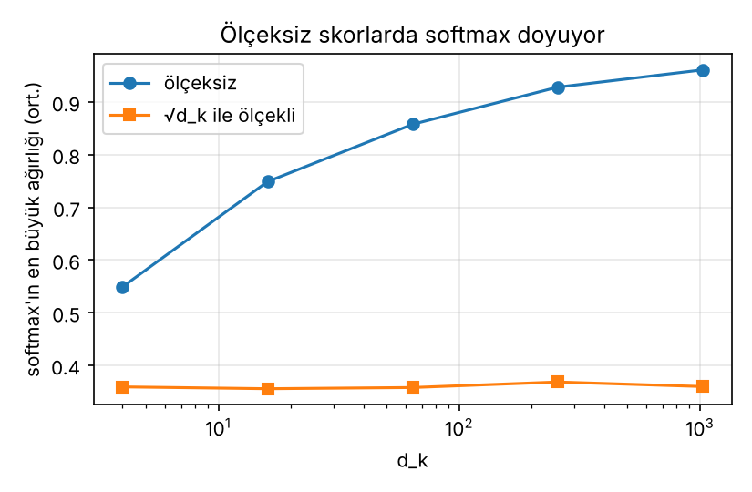
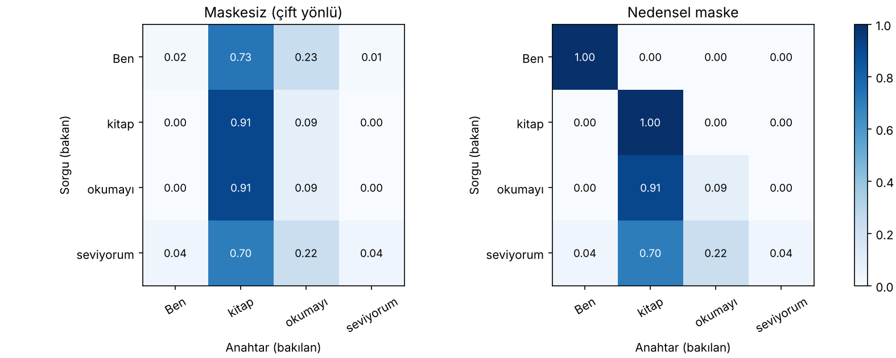

# 02 – Ölçeklenmiş nokta çarpımı dikkati (uygulama)

```
Attention(Q, K, V) = softmax( Q Kᵀ / √d_k + M ) V
```

Dikkat hesabının NumPy ile küçük bir örnek üzerinde adım adım kodlanması, √d_k ölçeklemesinin gerekçesi, nedensel maske ve dikkat matrisinin görselleştirilmesi.

```bash
python olceklenmis_dikkat.py
```

Çıktılar: terminalde adım adım matrisler, `figures/dikkat_matrisi.png`, `figures/olcekleme_doygunluk.png`.

## 1. Örnek veri

Dört token, gömme boyutu 4, `d_k = d_v = 3`:

```
Ben, kitap, okumayı, seviyorum

X = [[1,0,1,0],      W_Q = [[1,0,1],   W_K = [[0,0,1],   W_V = [[0,2,0],
     [0,2,0,2],             [1,0,0],          [1,1,0],          [0,3,0],
     [1,1,1,1],             [0,0,1],          [0,1,0],          [1,0,3],
     [0,1,1,0]]             [0,1,1]]          [1,0,1]]          [1,1,0]]
```

## 2. Adım adım

**Adım 1 – Q, K, V.** Örneğin `Q₁ = x₁ W_Q = [1,0,1,0]·W_Q = [1, 0, 2]`.

```
Q = [[1,0,2],[2,2,2],[2,1,3],[1,0,1]]
K = [[0,1,1],[4,2,2],[2,2,2],[1,2,0]]
V = [[1,2,3],[2,8,0],[2,6,3],[1,3,3]]
```

**Adım 2 – ham skorlar S = Q Kᵀ.** Örnek: `S₁₁ = Q₁·K₁ = [1,0,2]·[0,1,1] = 2`, `S₁₂ = [1,0,2]·[4,2,2] = 8`.

```
S = [[ 2,  8,  6, 1],
     [ 4, 16, 12, 6],
     [ 4, 16, 12, 4],
     [ 1,  6,  4, 1]]
```

**Adım 3 – ölçekleme.** `d_k = 3`, `√3 = 1.7321`:

```
S/√3 = [[1.1547, 4.6188, 3.4641, 0.5774],
        [2.3094, 9.2376, 6.9282, 3.4641],
        [2.3094, 9.2376, 6.9282, 2.3094],
        [0.5774, 3.4641, 2.3094, 0.5774]]
```

**Adım 4 – satır bazında softmax.**

```
A = [[0.0229, 0.7331, 0.2310, 0.0129],
     [0.0009, 0.9063, 0.0900, 0.0028],
     [0.0009, 0.9080, 0.0902, 0.0009],
     [0.0391, 0.7009, 0.2209, 0.0391]]     (her satırın toplamı 1)
```

**Adım 5 – çıktı O = A V.**

```
O = [[1.9642, 7.3358, 0.8006],
     [1.9963, 7.8006, 0.2812],
     [1.9982, 7.8098, 0.2759],
     [1.9218, 7.1283, 0.8972]]
```

> Bu örnekte `K₂` büyük olduğu için bütün sorgular ağırlıklı olarak 2. tokena bakıyor. Matrisler elle seçildi, gerçek bir modelin öğrenilmiş davranışı değildir; amaç hesap akışını göstermektir.

## 3. √d_k neden gerekli?

q ve k bileşenleri bağımsız, ortalaması 0 ve varyansı 1 ise `q·k = Σ q_i k_i` toplamının varyansı **d_k** olur, standart sapması **√d_k**. Ölçeksiz skorlar d_k ile büyür; büyük skorlarda softmax tek bir elemana yığılır (doygunluk). softmax'ın Jacobian'ının köşegeni `p_i(1−p_i)` olduğundan, `p_i ≈ 1` olduğunda gradyan ≈ 0 olur. √d_k'ya bölmek skor varyansını d_k'dan bağımsız hale getirir.

Deney (tek sorgu, 8 anahtar, her d_k için 200 tekrar, N(0,1) bileşenler):

| d_k | skor std (ölçeksiz) | skor std (ölçekli) | softmax maks. (ölçeksiz) | softmax maks. (ölçekli) |
|---:|---:|---:|---:|---:|
| 4 | 1.756 | 0.878 | 0.549 | 0.359 |
| 16 | 3.568 | 0.892 | 0.749 | 0.356 |
| 64 | 7.202 | 0.900 | 0.858 | 0.358 |
| 256 | 14.483 | 0.905 | 0.928 | 0.368 |
| 1024 | 28.591 | 0.893 | 0.961 | 0.360 |

- Ölçeksiz std ≈ √d_k'ya yakın (2, 4, 8, 16, 32); 8 örnekli std tahmini hafif aşağı yanlı olduğu için biraz altında kalıyor.
- Ölçekli std her d_k için ≈ 0.9 civarında sabit.
- Ölçeksizde en büyük softmax ağırlığı d_k = 1024'te 0.96'ya çıkıyor, yani dağılım neredeyse tek-sıcak. Ölçeklide ≈ 0.36'da kalıyor.

> Gradyanın sıfıra gitmesi burada analitik olarak anlatıldı (`p(1−p)`); bu betik gradyanı doğrudan ölçmez.



## 4. Nedensel maske

Otoregresif (kod çözücü) modelde i. konum gelecekteki j > i konumlarına bakamaz. Skorlara, yasak konumlara `−∞` (kodda `−1e9`) eklenir; softmax'tan sonra bu ağırlıklar 0 olur.

```
M = [[1,0,0,0],
     [1,1,0,0],
     [1,1,1,0],
     [1,1,1,1]]
```

Maskeli dikkat ağırlıkları:

```
[[1.0000, 0,      0,      0     ],
 [0.0010, 0.9990, 0,      0     ],
 [0.0009, 0.9088, 0.0903, 0      ],
 [0.0391, 0.7009, 0.2209, 0.0391]]
```

İlk satır tek bir seçeneğe sahip (kendisi) olduğundan ağırlık 1'dir. Son satır maskesizle aynıdır çünkü son token zaten tüm geçmişi görür.



## Kaynaklar

- Vaswani vd. (2017), *Attention Is All You Need*, NeurIPS
- Alammar (2018), *The Illustrated Transformer* (blog yazısı)
