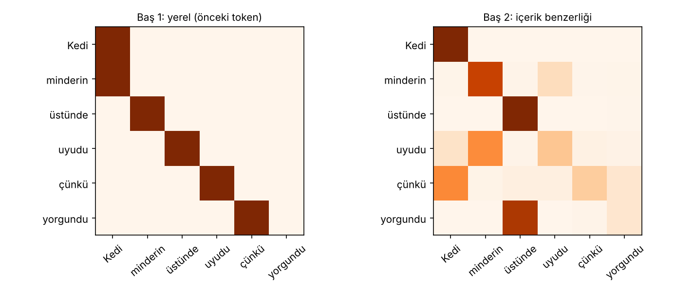
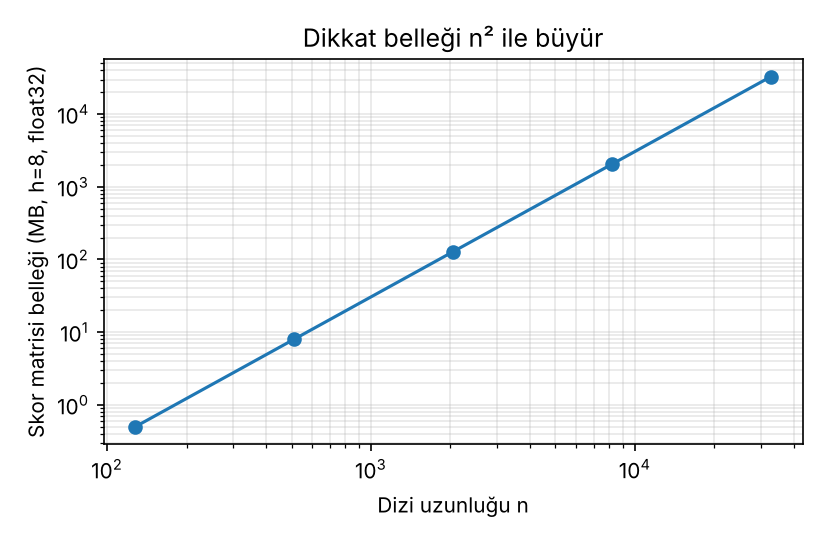

# 03 – Çok başlı dikkat ve dikkatin yorumlanması

```
head_i       = Attention(X W_Q^i, X W_K^i, X W_V^i)
MultiHead(X) = Concat(head_1, …, head_h) W_O
```

Öz-dikkat ve çapraz dikkat, çok başlı dikkatin gerekçesi, dikkatin dizi uzunluğuna göre karesel hesap ve bellek maliyeti ve dikkat ağırlıklarının model kararını açıklamak için kullanılıp kullanılamayacağı tartışması.

```bash
python cok_basli_dikkat.py
```

Çıktılar: terminalde şekil takibi ve tablolar, `figures/basliklar.png`, `figures/maliyet.png`.

## 1. Öz-dikkat ve çapraz dikkat

İkisi de aynı formülü kullanır; fark **Q, K, V'nin nereden geldiğidir**:

| | Q | K, V | Kullanım |
|---|---|---|---|
| **Öz-dikkat** | X | X (aynı dizi) | Kodlayıcıda ve kod çözücünün maskeli katmanında |
| **Çapraz dikkat** | kod çözücü durumları | kodlayıcı çıktısı | Kod çözücüde, kaynağa bakmak için |

`CokBasliDikkat.__call__(X_sorgu, X_baglam=None)`: `X_baglam` verilmezse öz-dikkat, verilirse çapraz dikkattir. Çapraz dikkatte dikkat matrisi dikdörtgendir: `(h, n_hedef, n_kaynak)`.

## 2. Şekil takibi (n = 6 token, d_model = 8, h = 2, d_k = 4)

```
X                      (6, 8)
X W_Q                  (6, 8)
böl  (h, n, d_k)       (2, 6, 4)        <- d_model, h parçaya bölünür
dikkat A (h, n, n)     (2, 6, 6)        <- her baş için ayrı matris
birleştir (n, d_model) (6, 8)
çıktı X' = concat · W_O (6, 8)
```

Çapraz dikkat (kod çözücü 3 token, kodlayıcı 6 token): `A = (2, 3, 6)`, çıktı `(3, 8)`.

## 3. Çok başlı dikkat neden?

- Tek başlı dikkatte her sorgu için **tek bir** ağırlık dağılımı vardır; bir token aynı anda hem sözdizimsel komşusuna hem anlamca ilgili uzak bir tokena güçlü bakamaz. Başlar, farklı alt uzaylarda farklı ilişkileri **paralel** öğrenebilir.
- Maliyet: `d_k = d_model / h` seçildiği için baş sayısı arttıkça her başın boyutu küçülür; **toplam parametre değişmez.** Doğrulama (d_model = 512, bias yok):

| h | d_k | parametre |
|---:|---:|---:|
| 1 | 512 | 1,048,576 |
| 2 | 256 | 1,048,576 |
| 8 | 64 | 1,048,576 |
| 16 | 32 | 1,048,576 |

Hepsi `4·d_model²` ile eşit (W_Q, W_K, W_V, W_O).



> **Uyarı.** Bu şekildeki iki matris **öğrenilmiş değildir.** Baş 1, "bir önceki tokena bak" örüntüsü elle kurulmuş; Baş 2 rastgele gömmelerin benzerliğinden hesaplanmış. Amaç, farklı başların farklı örüntü taşıyabileceğini göstermek. Gerçek modellerde başların ne yaptığına ilişkin bulgular için aşağıdaki Clark vd. (2019) özetine bakın.

## 4. Dikkatin dizi uzunluğuna göre maliyeti

Dikkat skor matrisi `h × n × n` elemanlıdır. Hesap: `QKᵀ` için `2n²d`, `AV` için `2n²d`, toplam yaklaşık `4n²d` FLOP (çarpma-toplama = 2 FLOP). d_model = 512, h = 8, float32:

| n | skor elemanı h·n² | bellek (MB) | FLOP ≈ 4·n²·d |
|---:|---:|---:|---:|
| 128 | 131,072 | 0.5 | 33,554,432 |
| 512 | 2,097,152 | 8.0 | 536,870,912 |
| 2,048 | 33,554,432 | 128.0 | 8,589,934,592 |
| 8,192 | 536,870,912 | 2,048.0 | 137,438,953,472 |
| 32,768 | 8,589,934,592 | 32,768.0 | 2,199,023,255,552 |

Uzunluk 4 katına çıkınca bellek ve hesap 16 katına çıkar. n = 32,768'de tek bir katmanın skor matrisi tek başına yaklaşık 32 GB'tır. Bu nedenle uzun bağlam için skor matrisini bütünüyle saklamayan uygulamalar (ör. FlashAttention) ve seyrek/yerel dikkat varyantları kullanılır; ancak dikkatin **hesap** karmaşıklığı yine `O(n²)`'dir.

Not: tablo yalnızca dikkat skorlarını sayar; FFN, gömme ve diğer katmanlar hariçtir. Değerler analitik hesaptır, gerçek bir GPU üzerinde ölçüm değildir.



## 5. Dikkat ağırlıkları bir açıklama mıdır?

Dikkat matrisini "model şuna baktığı için bu kararı verdi" diye okumak cazip. Literatür bu konuda bölünmüş durumdadır (aşağıdakiler makalelerin ana iddialarının özetidir; bu repoda yeniden üretilmedi):

- **Clark vd. (2019), *What Does BERT Look At?*** – BERT'in başlarını inceler. Bazı başlar belirli ayırıcı tokenlara (ör. `[SEP]`, noktalama) ağırlık verir, bazıları sabit göreli konumlara bakar, bazıları da belirli sözdizimsel ilişkilerle (ör. fiil–nesne) örtüşür. Yani dikkat başları **yorumlanabilir örüntüler** taşıyabilir.
- **Jain ve Wallace (2019), *Attention is not Explanation*** – Dikkat ağırlıkları ile gradyan tabanlı özellik önemleri çoğu zaman zayıf ilişkilidir ve model çıktısını neredeyse hiç değiştirmeyen **farklı dikkat dağılımları** bulunabilir; dolayısıyla ağırlıklar kararın güvenilir açıklaması sayılamaz.
- **Wiegreffe ve Pinter (2019), *Attention is not not Explanation*** – Sonucun "açıklama"nın nasıl tanımlandığına bağlı olduğunu savunur; karşı örnek dağılımların aranışının yöntemsel eksiklerini gösterir ve daha sıkı testlerle dikkatin belli koşullarda anlamlı açıklama sunabildiğini tartışır.

Pratik çıkarım: dikkat haritası **hipotez üretmek** için iyi bir araçtır; bir kararın nedenini kanıtlamak için tek başına yeterli değildir. Müdahale (ablasyon) deneyleri ve gradyan tabanlı yöntemlerle desteklenmelidir.

## Kaynaklar

- Vaswani vd. (2017), *Attention Is All You Need*, NeurIPS
- Clark vd. (2019), *What Does BERT Look At? An Analysis of BERT's Attention*, BlackboxNLP
- Jain ve Wallace (2019), *Attention is not Explanation*, NAACL
- Wiegreffe ve Pinter (2019), *Attention is not not Explanation*, EMNLP
