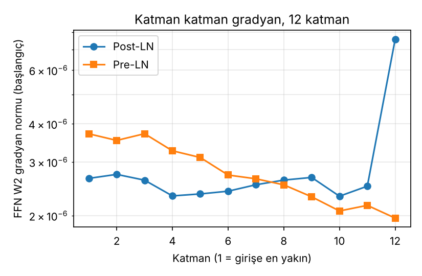
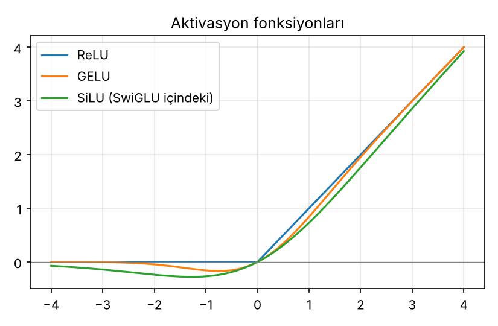

# 04 – Transformer bloğu

Artık bağlantılar, katman normalizasyonu (Post-LN ve Pre-LN, LayerNorm ve RMSNorm), ileri beslemeli katman aktivasyonları (ReLU, GELU, SwiGLU), kodlayıcı ve kod çözücü bloklarının karşılaştırılması ve bir modelin parametre sayısının hesaplanması.

```bash
python transformer_blogu.py
```

Çıktılar: terminalde hesaplar ve PyTorch doğrulamaları, `figures/aktivasyonlar.png`, `figures/gradyan_post_pre.png`.

## 1. Artık bağlantı ve normalizasyon konumu

Bir alt katman `F` (dikkat veya FFN) etrafında iki düzen vardır:

```
Post-LN :  y = LN( x + F(x) )         (orijinal Transformer)
Pre-LN  :  y = x + F( LN(x) )         (GPT-2 ve sonrası; son çıktıya ayrıca bir LN)
```

Artık bağlantı `x + F(x)` gradyanın katmanlardan doğrudan geçebileceği bir "otoyol" açar. Pre-LN'de bu yol normalizasyondan geçmez; Post-LN'de her bloğun çıkışı normalize edilir. Xiong vd. (2020), Post-LN'de başlangıçta gradyanların çıkışa yakın katmanlarda büyük olduğunu, bu yüzden öğrenme oranı ısınması (warm-up) gerektiğini, Pre-LN'de ise gradyanların daha dengeli olduğunu gösterdi.

### Deney: başlangıçta katman katman gradyan (12 katman, d = 64, tek tohum)

Her katmanın FFN çıkış ağırlığının (`W2`) gradyan normu, eğitimden önce `loss.backward()` sonrası:

| katman | Post-LN | Pre-LN |
|---:|---:|---:|
| 1 | 2.651e-06 | 3.711e-06 |
| 2 | 2.732e-06 | 3.530e-06 |
| 3 | 2.615e-06 | 3.714e-06 |
| 4 | 2.322e-06 | 3.265e-06 |
| 5 | 2.357e-06 | 3.104e-06 |
| 6 | 2.406e-06 | 2.718e-06 |
| 7 | 2.526e-06 | 2.642e-06 |
| 8 | 2.617e-06 | 2.525e-06 |
| 9 | 2.670e-06 | 2.307e-06 |
| 10 | 2.317e-06 | 2.073e-06 |
| 11 | 2.499e-06 | 2.162e-06 |
| 12 | 7.580e-06 | 1.964e-06 |

Son/ilk oranı: Post-LN **2.86**, Pre-LN **0.53**.



**Nasıl okunmalı.** Post-LN'de son (çıkışa en yakın) katmanın gradyanı diğerlerinin yaklaşık 3 katı; Pre-LN'de böyle bir sıçrama yok. Bu, Xiong vd.'nin gözlemiyle aynı yönde. **Sınırlar:** tek rastgele tohum, yalnızca başlangıç, 12 katmanlı küçük model ve tek bir kayıp; etki büyüklüğü katman sayısı ve ölçekle değişir. Bu bir tekrar-üretim değil, yönü gösteren küçük bir deneydir.

## 2. LayerNorm ve RMSNorm – el hesabı

`x = [2, −1, 4, 3]`

**LayerNorm:** `μ = 2.0`, `σ² = 3.5`, `ε = 1e-5`.

```
(x − μ) / √(σ² + ε) = [0, −1.6036, 1.0690, 0.5345]     ortalama 0, varyans 1
```

**RMSNorm:** `RMS = √(mean(x²) + ε) = √(7.5) = 2.7386`

```
x / RMS = [0.7303, −0.3651, 1.4606, 1.0954]            ortalama 0.7303 (sıfırlanmaz), RMS = 1
```

RMSNorm ortalamayı çıkarmaz (yeniden merkezleme yok), yalnızca ölçekler; `β` parametresi de yoktur. Bu yüzden daha az hesap ve parametre kullanır (d = 64 için LayerNorm 128, RMSNorm 64 parametre). Zhang ve Sennrich (2019), yeniden merkezlemenin ölçekleme değişmezliğinin yanında gereksiz olduğunu öne sürer.

## 3. Aktivasyonlar

| x | ReLU | GELU | SiLU |
|---:|---:|---:|---:|
| −3.0 | 0.0000 | −0.0040 | −0.1423 |
| −1.0 | 0.0000 | −0.1587 | −0.2689 |
| −0.5 | 0.0000 | −0.1543 | −0.1888 |
| 0.0 | 0.0000 | 0.0000 | 0.0000 |
| 0.5 | 0.5000 | 0.3457 | 0.3112 |
| 1.0 | 1.0000 | 0.8413 | 0.7311 |
| 3.0 | 3.0000 | 2.9960 | 2.8577 |

- `ReLU(x) = max(0, x)`
- `GELU(x) = x·Φ(x)`, Φ standart normal CDF (tam form, `erf` ile)
- `SiLU(x) = x·σ(x)`

ReLU negatif girdilerde tam sıfır verir; GELU/SiLU küçük negatif değerlere izin verir ve her yerde türevlenebilirdir.



### SwiGLU

Standart FFN: `W₂ · act(W₁ x)` → iki matris, `2·d·d_ff` parametre.
SwiGLU (Shazeer, 2020): `W₂ · ( SiLU(W_gate x) ⊙ (W_up x) )` → **üç** matris, `3·d·d_ff'` parametre.

Parametre bütçesini sabit tutmak için `d_ff' = (2/3)·d_ff` seçilir (yaygın uygulama). d = 4096, `d_ff = 4d` için:

```
standart FFN : 2 · 4096 · 16384          = 134,217,728
SwiGLU       : 3 · 4096 · 10922 (=2/3·4d) = 134,209,536      (≈ aynı)
```

PyTorch ile doğrulama: `SwiGLU(d=64, d_ff=170)` = 32,640 parametre = 3·64·170.

## 4. Kodlayıcı ve kod çözücü bloğu

| | Kodlayıcı | Kod çözücü |
|---|---|---|
| Dikkat alt katmanları | 1 (öz-dikkat) | 2 (maskeli öz-dikkat + çapraz dikkat) |
| Dikkat maskesi | yok (çift yönlü) | nedensel (yalnız geçmiş) |
| K, V kaynağı | kendi girdisi | çapraz dikkatte kodlayıcı çıktısı |
| Alt katman sayısı | 2 (dikkat, FFN) | 3 (dikkat, çapraz dikkat, FFN) |
| Katman başına parametre (base) | 3,152,384 | 4,204,032 |

## 5. Parametre sayısı – Transformer-base (d = 512, d_ff = 2048, h = 8, N = 6)

Bias'lı doğrusal katmanlar için:

```
Çok başlı dikkat : 4·d² + 4·d                 = 4·262,144 + 2,048          = 1,050,624
FFN              : 2·d·d_ff + d_ff + d        = 2,097,152 + 2,048 + 512    = 2,099,712
LayerNorm        : 2·d (γ ve β)               = 1,024

Kodlayıcı katmanı: dikkat + FFN + 2·LN        = 1,050,624 + 2,099,712 + 2,048   = 3,152,384
Kod çözücü katmanı: 2·dikkat + FFN + 3·LN     = 2,101,248 + 2,099,712 + 3,072   = 4,204,032

Toplam (6 kodlayıcı + 6 kod çözücü)           = 6·3,152,384 + 6·4,204,032       = 44,138,496
```

**PyTorch doğrulaması:**

| | formül | PyTorch |
|---|---:|---:|
| `TransformerEncoderLayer` | 3,152,384 | 3,152,384 (eşit) |
| `TransformerDecoderLayer` | 4,204,032 | 4,204,032 (eşit) |
| `nn.Transformer` (6+6, son LN'ler dahil) | 44,138,496 + 2·2·512 | 44,140,544 (eşit) |

Bu sayı **gömme (embedding) ve çıkış katmanı hariçtir**; onlar sözlük boyutuna bağlıdır (`V·d`). Ayrıca bu, yalnızca bu mimari ayarı içindir; farklı model için formüldeki `d`, `d_ff`, `N` değiştirilir.

## Kaynaklar

- Vaswani vd. (2017), *Attention Is All You Need*, NeurIPS
- Xiong vd. (2020), *On Layer Normalization in the Transformer Architecture*, ICML
- Zhang ve Sennrich (2019), *Root Mean Square Layer Normalization*, NeurIPS
- Shazeer (2020), *GLU Variants Improve Transformer*, arXiv
