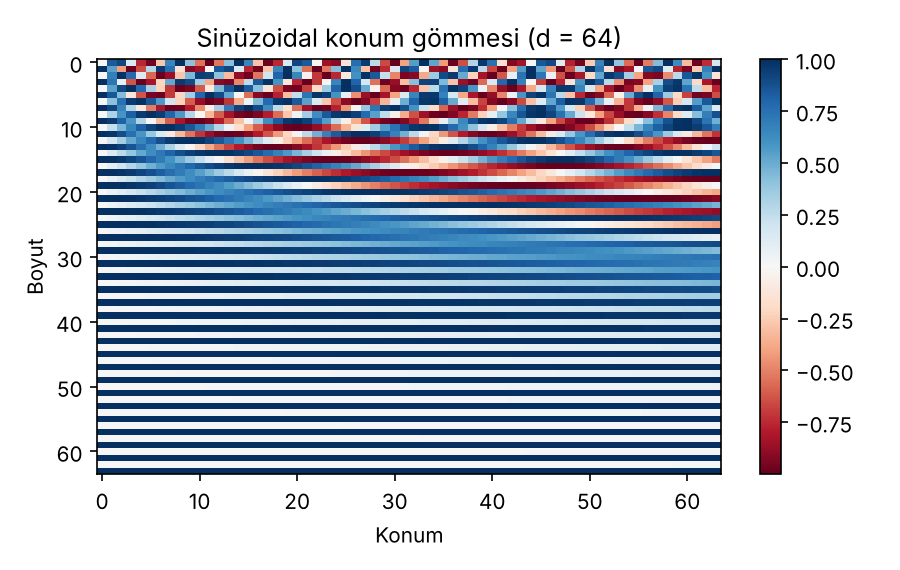
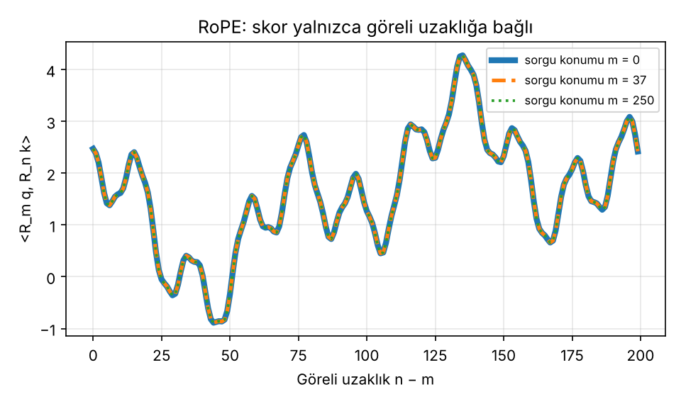
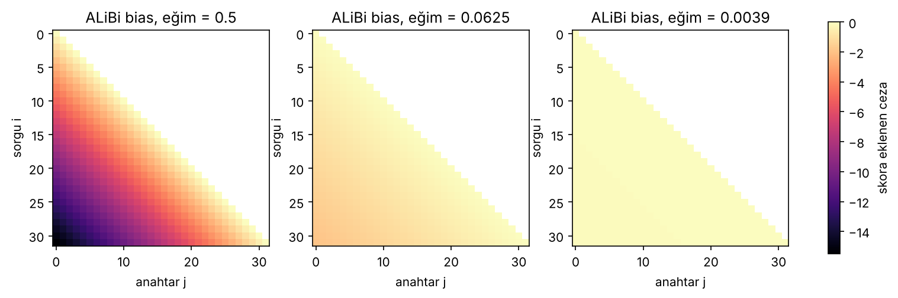

# 05 – Konum kodlama: sinüzoidal gömmelerden RoPE ve ALiBi'ye

Öz-dikkat bir tokenin hangi sırada olduğunu **kendiliğinden bilmez**: girdi tokenlarının sırası değişirse çıktılar aynı şekilde yer değiştirir (permütasyon eşdeğişkenliği). "Köpek adamı ısırdı" ile "Adam köpeği ısırdı" arasındaki fark ancak konum bilgisi verilirse ayırt edilebilir. Bu klasörde bu bilgiyi vermenin üç yolu kodlanır.

```bash
python konum_kodlama.py
```

Çıktılar: terminalde hesaplar, `figures/sinuzoidal_pe.png`, `figures/rope_skor.png`, `figures/alibi_bias.png`.

| Yöntem | Konum bilgisi nereye verilir? | Mutlak / göreli | Öğrenilen parametre |
|---|---|---|---|
| Sinüzoidal | girdi gömmesine **eklenir** | mutlak (göreli ilişki çıkarılabilir) | yok |
| Öğrenilen gömme | girdi gömmesine eklenir | mutlak | `n_maks × d` |
| RoPE | q ve k vektörleri **döndürülür** | göreli | yok |
| ALiBi | dikkat skoruna **ceza eklenir** | göreli | yok |

## 1. Sinüzoidal konum gömmesi

```
PE(pos, 2i)   = sin( pos / 10000^(2i/d) )
PE(pos, 2i+1) = cos( pos / 10000^(2i/d) )
```

`d = 4`, ilk 4 konum:

```
pos 0: [ 0.0000,  1.0000, 0.0000, 1.0000]
pos 1: [ 0.8415,  0.5403, 0.0100, 1.0000]
pos 2: [ 0.9093, -0.4161, 0.0200, 0.9998]
pos 3: [ 0.1411, -0.9900, 0.0300, 0.9996]
```

**El hesabı, pos = 1:** `i = 0` için payda `10000^0 = 1`, `i = 1` için `10000^(2/4) = 100`:

```
sin(1/1) = 0.8415   cos(1/1) = 0.5403   sin(1/100) = 0.0100   cos(1/100) = 1.0000
```

İlk boyut çiftleri hızlı, sonrakiler yavaş döner (farklı frekanslar), tıpkı bir sayının basamakları gibi.



**Neden sinüs/kosinüs?** `PE(pos + k)`, `PE(pos)`'un **doğrusal** bir fonksiyonudur: her `(sin, cos)` çifti için toplam açı formülleri bir döndürme matrisi `R(k)` verir:

```
sin(a + b) = sin a · cos b + cos a · sin b
cos(a + b) = cos a · cos b − sin a · sin b
```

Sayısal doğrulama (`d = 8`, `pos = 5`, `k = 3`): `PE(8)` ile `R(3)·PE(5)` arasındaki en büyük fark **1.1e-16** (makine hassasiyeti). Dolayısıyla model, göreli uzaklığı doğrusal katmanlarla çıkarabilir.

## 2. RoPE (Rotary Position Embedding)

Fikir: konumu girdiye eklemek yerine, **q ve k vektörlerini konuma bağlı bir açıyla döndür.** Boyutlar ikişerli çiftlenir; `m` konumundaki bir vektörün i. çifti `m·θ_i` kadar döndürülür, `θ_i = 10000^(−2i/d)`:

```
[x₂ᵢ ]'   [ cos(mθᵢ)  −sin(mθᵢ) ] [x₂ᵢ ]
[x₂ᵢ₊₁] = [ sin(mθᵢ)   cos(mθᵢ) ] [x₂ᵢ₊₁]
```

**2 boyutlu el örneği** (θ = 1 rad), `q = [1, 0]`:

```
konum 0: R₀ q = [ 1.0000, 0.0000]
konum 1: R₁ q = [ 0.5403, 0.8415]     (= cos 1, sin 1)
konum 2: R₂ q = [-0.4161, 0.9093]     (= cos 2, sin 2)
```

**Neden göreli?** Döndürme matrisleri için `R_mᵀ = R_{−m}` ve `R_{−m} R_n = R_{n−m}` olduğundan:

```
⟨R_m q, R_n k⟩ = qᵀ R_mᵀ R_n k = qᵀ R_{n−m} k
```

Skor yalnızca **n − m**'ye bağlıdır, mutlak konumlara değil. Sayısal doğrulama (`d = 16`, rastgele q, k):

| (m, n) | n − m | skor |
|---|---:|---:|
| (0, 3) | 3 | 1.919427 |
| (5, 8) | 3 | 1.919427 |
| (20, 23) | 3 | 1.919427 |
| (100, 103) | 3 | 1.919427 |
| (0, 10) | 10 | 1.618282 |
| (7, 17) | 10 | 1.618282 |

Aynı uzaklık, farklı mutlak konumlarda **aynı skoru** veriyor. Şekilde skor, göreli uzaklığın fonksiyonu olarak sorgu konumu `m = 0`, `37` ve `250` için çizildi; üç eğri üst üste biniyor (aralarındaki en büyük fark **1.1e-14**, yani yalnızca kayan nokta yuvarlaması).



## 3. ALiBi

Konum gömmesi yok. Dikkat skoruna, sorgu ile anahtar arasındaki uzaklıkla orantılı bir ceza eklenir:

```
skor_ij = q_i · k_j / √d_k  −  m_h · (i − j)          (j ≤ i)
m_h = 2^(−8h/H),  h = 1…H
```

`H = 8` baş için eğimler: `[1/2, 1/4, 1/8, 1/16, 1/32, 1/64, 1/128, 1/256]`. Her baş farklı bir "bakış penceresi" kazanır: büyük eğim yakına, küçük eğim uzağa odaklanır.

Eğim 0.5 için 5 tokenlik bias matrisi (üst üçgen nedensel maske ile kapalı):

```
[[ 0                       ]
 [-0.5   0                 ]
 [-1.0  -0.5   0           ]
 [-1.5  -1.0  -0.5   0     ]
 [-2.0  -1.5  -1.0  -0.5  0]]
```

**Etkinin gösterimi:** 8 geçmiş tokena aynı ham skorlarla bakan son token için dikkat ağırlıkları (mesafe 7 … 0):

| eğim | ağırlıklar |
|---:|---|
| 0.00 | 0.1202 0.1934 0.1183 0.0231 0.2103 0.1329 0.0497 0.1521 |
| 0.25 | 0.0438 0.0904 0.0711 0.0178 0.2082 0.1689 0.0811 0.3187 |
| 1.00 | 0.0005 0.0024 0.0040 0.0021 0.0522 0.0897 0.0912 0.7580 |

Eğim büyüdükçe en yakın token baskın hale gelir (0.15 → 0.32 → 0.76).



*Renk skalası üç panelde ortaktır: 0.5 eğimli baş uzağı güçlü cezalandırırken 0.0039 eğimli baş neredeyse hiç cezalandırmaz.*

## 4. Eğitimde görülenden uzun dizilere genelleme

Yöntemin eğitim uzunluğunun ötesinde çalışıp çalışmayacağı, konum bilgisinin nasıl temsil edildiğine bağlıdır:

| Yöntem | Eğitimde görülmeyen uzunlukta |
|---|---|
| Öğrenilen mutlak gömme | n_maks'tan sonrası için **satır yoktur**; tanımsız |
| Sinüzoidal | formül her konum için tanımlıdır, ancak model o konum aralığını hiç görmediği için davranış garanti değildir |
| RoPE | skor göreli uzaklığa bağlıdır; tanımlıdır, ancak görülmemiş açı aralıkları kalite kaybına yol açabilir |
| ALiBi | bias doğrusal ve parametresizdir; uzunluk sınırı yoktur |

> **Not.** Bu tablo yapısal/niteliksel bir değerlendirmedir; bu repoda **uzun dizi doğruluğu ölçülmedi**. ALiBi makalesi (Press vd., 2022), ALiBi'nin kısa eğitilip uzun test edildiğinde sinüzoidal ve rotary yaklaşımlardan daha iyi genelleme sağladığını raporlar; ölçüm ve koşullar için makaleye bakın.

## Kaynaklar

- Vaswani vd. (2017), *Attention Is All You Need*, NeurIPS
- Shaw vd. (2018), *Self-Attention with Relative Position Representations*, NAACL
- Su vd. (2024), *RoFormer: Enhanced Transformer with Rotary Position Embedding*, Neurocomputing
- Press vd. (2022), *Train Short, Test Long: Attention with Linear Biases Enables Input Length Extrapolation*, ICLR
