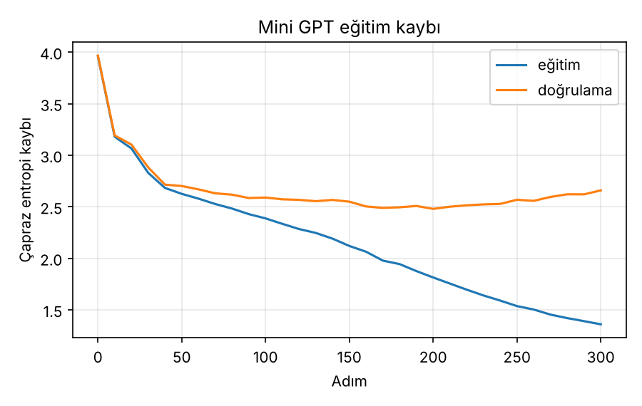
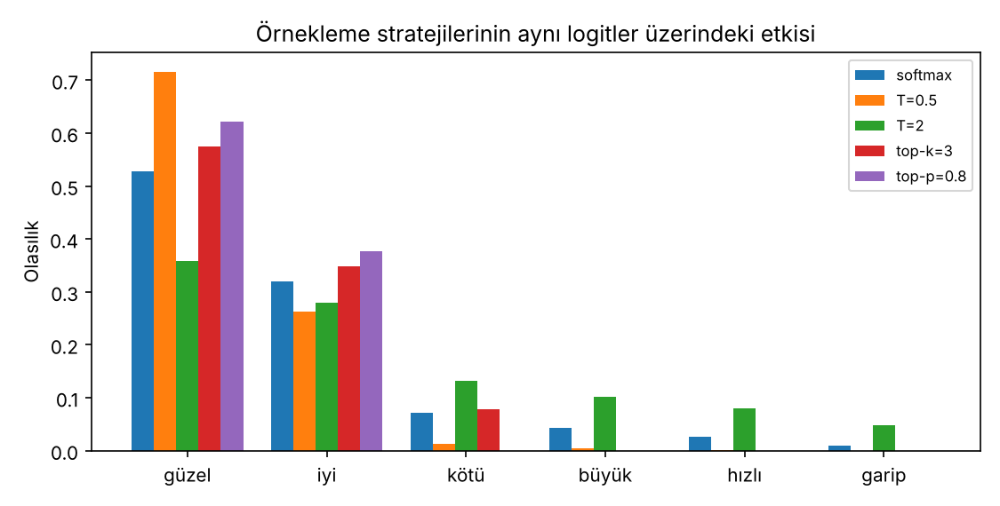

# 06 – Küçük bir GPT'nin sıfırdan kodlanması (uygulama)

PyTorch ile karakter düzeyinde, yalnız kod çözücülü küçük bir dil modeli kurulur ve eğitilir; eğitim kaybı izlenir; metin üretiminde açgözlü seçim, sıcaklık, top-k ve top-p örneklemesi karşılaştırılır.

```bash
pip install -r ../requirements.txt
python mini_gpt.py          # eğitir -> gpt.pt, figures/egitim_kaybi.png   (2 CPU çekirdeğinde ~30 sn)
python ornekleme.py         # gpt.pt ile stratejileri karşılaştırır, figures/ornekleme_stratejileri.png
```

Dosyalar: `mini_gpt.py` (veri, model, eğitim), `ornekleme.py` (strateji fonksiyonları ve karşılaştırma), `veri.txt` (eğitim metni). `gpt.pt` repoya eklenmez (`.gitignore`).

## 1. Mimari

```
token gömme + öğrenilen konum gömmesi
N × Blok:   x = x + NedenselÖzDikkat( LN(x) )
            x = x + FFN( LN(x) )              FFN: Linear(d, 4d) → GELU → Linear(4d, d)
son LN → Linear(d, vocab)                      (ağırlıklar token gömmesiyle paylaşılır)
```

| Ayar | Değer |
|---|---|
| Sözlük (karakter sayısı) | 51 |
| Bağlam uzunluğu (blok) | 64 |
| d_model / baş / katman | 96 / 4 / 3 |
| Parametre sayısı | 346,752 |
| Normalizasyon | Pre-LN (bkz. `04_transformer_blogu`) |
| Dikkat | nedensel maskeli çok başlı öz-dikkat (bkz. `02`, `03`) |

**Eğitim hedefi.** Girdi `x[t]` iken hedef `x[t+1]`: sonraki karakteri tahmin etmek. Kayıp, tüm konumlar üzerinde ortalama çapraz entropidir. Eğitilmemiş modelin beklenen kaybı `ln(51) = 3.932`; gözlenen başlangıç kaybı 3.960, yani rastgele tahminle uyumlu.

Optimizasyon: AdamW (lr 3e-3, weight decay 0.01), kosinüs öğrenme oranı azaltma, gradyan kırpma 1.0, batch 32, 300 adım, tohum 1337.

## 2. Eğitim kaybı – ve ezber

`veri.txt` yalnızca **2,732 karakterdir** (9 kısa paragraf). Bu, modelin parametre sayısının (346 bin) çok altındadır; model genelleme yerine ezberlemeye çok hızlı geçer.

| adım | eğitim kaybı | doğrulama kaybı |
|---:|---:|---:|
| 0 | 3.960 | 3.966 |
| 50 | 2.625 | 2.701 |
| 100 | 2.387 | 2.589 |
| 200 | 1.814 | **2.479** (en düşük) |
| 300 | 1.359 | 2.659 |



Doğrulama kaybı yaklaşık 200. adımda en düşük, sonra **yükseliyor**: aşırı uyum (overfitting) başlıyor. Karşılaştırma için aynı model 1500 adım eğitildiğinde eğitim kaybı 0.093'e inerken doğrulama kaybı 5.873'e çıktı (tam ezber).

Varsayılan 300 adım bilinçli seçildi: model yarı yarıya ezberlemiş durumda, yani örnekleme stratejilerinin farkı görülebilecek kadar çeşitli ama hâlâ Türkçeye benzer çıktı veriyor. **Bu bir kalite iddiası değildir.** Daha anlamlı bir model için kendi büyük metnini ver:

```bash
python mini_gpt.py --veri buyuk_metin.txt --adim 3000
```

## 3. Örnekleme stratejileri

Model her adımda 51 karakter üzerinde **logit** üretir; bir sonraki karakter bu dağılımdan seçilir. Aynı dağılımı farklı biçimlerde keskinleştirip/budayarak seçim yapılır.

### Küçük logit örneği (`z = [3.0, 2.5, 1.0, 0.5, 0.0, −1.0]`)

| | güzel | iyi | kötü | büyük | hızlı | garip |
|---|---:|---:|---:|---:|---:|---:|
| softmax (T=1) | 0.5285 | 0.3206 | 0.0715 | 0.0434 | 0.0263 | 0.0097 |
| sıcaklık T=0.5 | 0.7165 | 0.2636 | 0.0131 | 0.0048 | 0.0018 | 0.0002 |
| sıcaklık T=2.0 | 0.3582 | 0.2790 | 0.1318 | 0.1026 | 0.0799 | 0.0485 |
| top-k (k=3) | 0.5741 | 0.3482 | 0.0777 | 0 | 0 | 0 |
| top-p (p=0.8) | 0.6225 | 0.3775 | 0 | 0 | 0 | 0 |

- **Açgözlü:** her adımda `argmax` → "güzel". Deterministiktir; tekrara düşmeye yatkındır.
- **Sıcaklık T:** `p_i ∝ exp(z_i / T)`. `T < 1` keskinleştirir (0.5285 → 0.7165), `T > 1` düzleştirir (→ 0.3582).
- **Top-k:** yalnızca en yüksek k olasılığı tut, yeniden normalize et. Örnekte `0.5285 / (0.5285+0.3206+0.0715) = 0.5741`.
- **Top-p (nucleus):** kümülatif olasılığı ≥ p olan **en küçük kümeyi** tut. Sıralı kümülatif: `0.5285, 0.8491, …`; p = 0.8 için ilk iki token (0.8491 ≥ 0.8) kalır. `0.5285 / 0.8491 = 0.6225`. Küme boyutu bağlama göre değişir: model emin olduğunda küçük, emin olmadığında büyük (top-k'dan farkı bu; Holtzman vd., 2020).



### Eğitilmiş modelle üretim

Başlangıç metni `"Kütüphane şehrin"`, aynı rastgelelik tohumu, her strateji için 160 karakter üretildi; aşağıda yalnızca ilk kısımları gösteriliyor (`...`):

```
[açgözlü ]  Kütüphane şehrin keski keski kadınında balanı. Bir tağışıcılar tava dağıla da da da dala dala dala a alarıştımı taka sonra bir bir tünün ...
[T=0.5   ]  Kütüphane şehrin skene tes i konutuşak balarını avlan danımırda bile bir bir tünün bün mütütüzde çü salala va birda va birdinini ...
[T=1.0   ]  Kütüphane şehrin ykeri tlerderi.ttizdek Amezyasa binu vabındur durdu. Havağın vada bıla yoluzon bür çir ka vele ada çalatak issı ...
[T=1.5   ]  Kütüphane şehrineyk gü vordolmduşmiş, saGenzisi. /  / Ge  Ökeârulm kiçin gibseındide fi.zcidusatİçlakçm ıtonda ımncı gAZüttuzEpmkluz ...
[top-k=5 ]  Kütüphane şehrin kerin kondundupzunu. Yandaşımık koklar konuklarar kada soyrda ban bınlar butor, solura si sonra da sonronrdu. ...
[top-p=0.9] Kütüphane şehrin ve ey tesk eskizleşbir am yavala. Ezar bünışıdanık bir soğrusu dimaş, döğlüzır. / Ge zgire eyen y, biyenen soluyolu ...
```

(Satır sonları `/` ile gösterildi. Çıktılar aynı yazılım/donanımda tekrarlanabilir; farklı PyTorch sürümlerinde karakter karakter aynı çıkmayabilir.)

### Sayısal karşılaştırma

Her strateji için 200 karakterlik 10 örnek (açgözlü deterministik olduğu için 1 örnek):

| strateji | benzersiz 4-gram oranı (çeşitlilik) | bilinen sözcük oranı (kalite göstergesi) |
|---|---:|---:|
| açgözlü | 0.737 | 0.436 |
| T=0.5 | 0.910 | 0.153 |
| T=1.0 | 0.982 | 0.076 |
| T=1.5 | 0.995 | 0.047 |
| top-k = 5 | 0.955 | 0.097 |
| top-p = 0.9 | 0.954 | 0.105 |

- **Benzersiz 4-gram oranı:** üretilen metindeki farklı 4 karakterlik parçaların oranı. Düşük = tekrar ("da da da", "bir bir").
- **Bilinen sözcük oranı:** üretilen sözcüklerin kaçı eğitim metninin sözcük dağarcığında geçiyor. Kaba bir kalite göstergesidir; geçerli ama eğitim metninde bulunmayan bir Türkçe sözcük de "bilinmeyen" sayılır.

**Okuma:** çeşitlilik ile kalite arasında açık bir takas var. Açgözlü seçim en "tanıdık" sözcükleri üretir ama tekrara düşer (en düşük çeşitlilik). Sıcaklık arttıkça çeşitlilik artar, kalite düşer; T = 1.5'te çıktı büyük ölçüde anlamsız karakter yığınıdır. Top-k ve top-p, aynı sıcaklıkta (T = 1) uç düşük olasılıklı karakterleri budadığı için ham örneklemeden (T = 1.0: 0.076) biraz daha yüksek kalite verir (0.097 ve 0.105), çeşitlilikten az taviz vererek.

## Sınırlamalar

- Önceden eğitilmiş bir model **kullanılmadı**: üretim, bu klasörde eğitilen 346 bin parametreli modelle yapıldı. `ornekleme.py`'deki strateji fonksiyonları yalnızca logit vektörü alır; başka bir modelin logitleri verilerek kullanılabilir.
- Veri çok küçük olduğu için üretilen metinler dilbilgisel olarak anlamlı değildir; sonuçlar **stratejilerin göreli davranışını** gösterir, mutlak kaliteyi değil.
- Sayılar tek eğitim çalıştırmasına ve tek tohuma aittir.

## Kaynaklar

- Rush (2018), *The Annotated Transformer*, NLP-OSS
- Karpathy, *nanoGPT* (GitHub deposu) – mimari ve eğitim döngüsü için ilham
- Holtzman vd. (2020), *The Curious Case of Neural Text Degeneration*, ICLR
