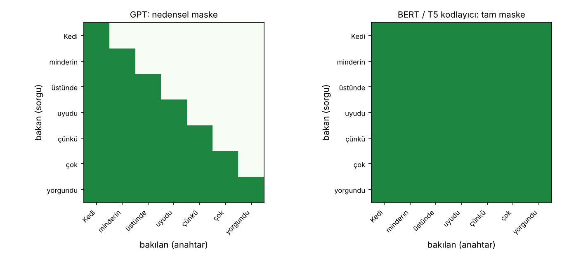
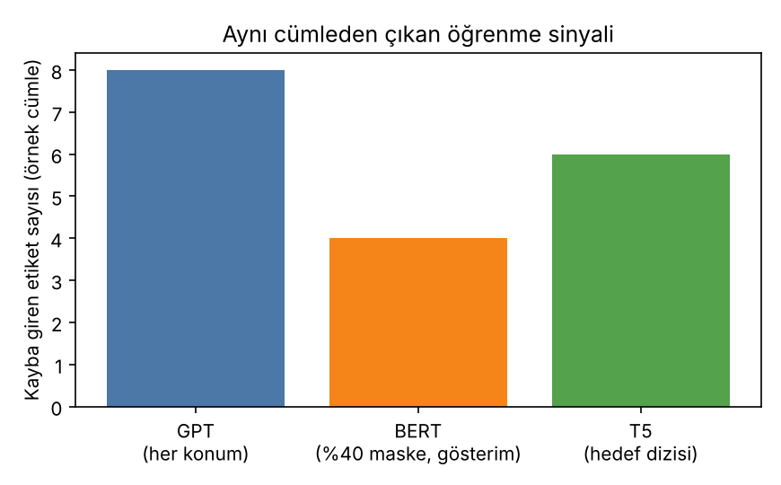

# 07 – Ön eğitim hedefleri: GPT, BERT ve T5

Nedensel dil modelleme, maskeli dil modelleme ve metinden metne çerçeve; yalnız kodlayıcı, yalnız kod çözücü ve kodlayıcı-kod çözücü modellerin karşılaştırılması; ön eğitim ve ince ayar paradigması; güncel üretici modellerin kod çözücü mimarisinde toplanmasının nedenleri.

```bash
python on_egitim_hedefleri.py
```

Çıktılar: terminalde üç hedefin girdi/etiket çiftleri, `figures/dikkat_maskeleri.png`, `figures/etiket_sayilari.png`.

Bu klasör **bir model eğitmez**; üç hedefin veriyi nasıl dönüştürdüğünü ve kaybın hangi konumlarda hesaplandığını tek bir örnek cümle üzerinde gösterir. (Eğitim örneği için `06_mini_gpt`'ye bakın.)

Örnek cümle (7 token): **Kedi minderin üstünde uyudu çünkü çok yorgundu**

## 1. GPT – nedensel dil modelleme (yalnız kod çözücü)

Hedef: `P(x_t | x_<t)`. Etiket, girdinin bir konum kaydırılmış halidir; her konum bir öğrenme sinyali üretir.

| konum | girdi | etiket |
|---:|---|---|
| 0 | `<BOS>` | Kedi |
| 1 | Kedi | minderin |
| 2 | minderin | üstünde |
| 3 | üstünde | uyudu |
| 4 | uyudu | çünkü |
| 5 | çünkü | çok |
| 6 | çok | yorgundu |
| 7 | yorgundu | `<EOS>` |

- Kayba giren konum: **8 / 8**.
- Dikkat maskesi **nedensel** (alt üçgen): 3. konum yalnızca 0–3'e bakar; yoksa etiketi (4. token) doğrudan görüp kopyalardı.
- Kayıp: `L = −(1/8) Σ log p(etiket_t | x_≤t)`.

## 2. BERT – maskeli dil modelleme (yalnız kodlayıcı)

Hedef: `P(x_maskeli | x_görünen)`. Her tokenin %15'i seçilir; seçilenlerin
- %80'i `<MASK>` ile değiştirilir,
- %10'u rastgele bir sözcükle değiştirilir,
- %10'u **aynen bırakılır** (model her tokenin doğru olabileceğini varsaymalı, yalnızca `<MASK>` görünen yerleri düzeltmemeli).

Gösterim için oran %40 yapıldı (7 tokenlik cümlede %15 ile çoğu zaman 1 token seçilir):

| konum | orijinal | girdi | kayba girer? |
|---:|---|---|---|
| 0 | Kedi | `<MASK>` | EVET |
| 1 | minderin | minderin | hayır |
| 2 | üstünde | üstünde | hayır |
| 3 | uyudu | uyudu | EVET *(seçildi, ama "aynen bırak" kuralı)* |
| 4 | çünkü | `<MASK>` | EVET |
| 5 | çok | çok | hayır |
| 6 | yorgundu | `<MASK>` | EVET |

- Kayba giren konum: **4 / 7**. Gerçek %15 oranıyla bu cümlede beklenen etiket sayısı ≈ 1.1; GPT'de 8.
- Dikkat maskesi **tam**: her token tüm cümleyi (sağını da) görür.
- Sonuç: aynı veriden **konum başına daha az öğrenme sinyali**; BERT tarzı modeller aynı veriyi genellikle daha çok geçişle (epoch) görür.

## 3. T5 – aralık bozma (kodlayıcı-kod çözücü)

Girdi–çıktı metindir. Ardışık aralıklar **tek bir sentinel** ile değiştirilir; hedef, sentinel'lerle ayrılmış silinen aralıklardır.

```
Orijinal          : Kedi minderin üstünde uyudu çünkü çok yorgundu
Silinen aralıklar : "minderin"  ve  "çünkü çok"
Kodlayıcı girdisi : Kedi <X> üstünde uyudu <Y> yorgundu
Kod çözücü hedefi : <X> minderin <Y> çünkü çok <Z>
```

- Kodlayıcı **tam** (çift yönlü) dikkatle bozuk girdiyi okur; kod çözücü **nedensel** dikkatle hedefi üretir ve her adımda **çapraz dikkatle** kodlayıcı çıktısına bakar.
- Kayıp yalnızca hedef dizisi üzerinde hesaplanır.
- Gösterimde cümlenin 3/7'si bozuldu, bu yüzden hedef (6 token) girdiden (6 token) kısa değil. T5 makalesindeki ayarda yaklaşık %15 token bozulur (ortalama aralık uzunluğu 3): kodlayıcı girdisi neredeyse orijinal uzunluktadır, hedef dizisi ise orijinalin küçük bir kısmıdır.

## 4. Dikkat maskeleri



Koyu = bakabilir. Sol: GPT'nin (ve T5 kod çözücünün öz-dikkatinin) nedensel maskesi. Sağ: BERT'in ve T5 kodlayıcısının tam maskesi. T5'in çapraz dikkati (kod çözücü → kodlayıcı) her kodlayıcı konumuna açıktır.



## 5. Karşılaştırma

| | GPT | BERT | T5 |
|---|---|---|---|
| Mimari | yalnız kod çözücü | yalnız kodlayıcı | kodlayıcı-kod çözücü |
| Dikkat | nedensel (soldan sağa) | çift yönlü | kodlayıcı çift yönlü; kod çözücü nedensel + çapraz |
| Ön eğitim hedefi | sonraki token | maskeli token | bozuk aralık → aralık |
| Kayıp konumları | tüm konumlar | ~%15 | yalnız hedef dizisi |
| Doğal kullanım | metin üretimi | sınıflandırma, etiketleme | çeviri, özetleme, soru-cevap |
| Üretim | doğal | doğal değil | doğal |

> **Not.** Bu repodaki kayıp değerleri, hesaplamanın hangi konumlarda yapıldığını göstermek için **rastgele logitlerle** hesaplandı (referans: `ln V = 2.64`); modelin kalitesi hakkında bir şey söylemezler.

## 6. Ön eğitim ve ince ayar paradigması

1. **Ön eğitim:** etiketsiz büyük metin üzerinde yukarıdaki hedeflerden biriyle genel bir dil temsili öğrenilir.
2. **İnce ayar:** aynı ağırlıklar, etiketli küçük bir görev verisiyle (sınıflandırma, soru-cevap, özetleme…) güncellenir.

Görev arayüzü modele göre değişir: GPT-1'de (Radford vd., 2018) görev girdileri tek bir diziye dönüştürülüp üzerine doğrusal bir katman eklenir; BERT'te `[CLS]` çıktısı üzerine görev başlığı konur; T5'te her görev metinden metne dönüştürülür ve girdiye bir görev öneki eklenir.

## 7. Güncel üretici modeller neden kod çözücü mimarisinde toplanıyor?

Aşağıdakiler literatürde ve uygulamada sık öne sürülen gerekçelerdir; bu repodaki kod bunları **ölçmez**:

- **Tek, basit hedef.** "Sonraki tokeni tahmin et", etiketsiz ham metinden ek hazırlık gerektirmeden ölçeklenir.
- **Her konumda sinyal.** Nedensel LM'de tüm konumlar kayba katılır (yukarıdaki 8/8 – 4/7 farkı); aynı hesap bütçesiyle daha fazla öğrenme sinyali.
- **Üretim ve görev aynı arayüzde.** Model, görevi komut/örnek olarak girdi metninin içinde alıp devamını üretir; görev başına ayrı başlık veya ince ayar gerekmez (istem/bağlam içi öğrenme).
- **Verimli çıkarım.** Nedensel maske, önceki tokenların anahtar–değer çiftlerinin önbelleğe alınmasına (KV cache) izin verir; her yeni token yalnızca kendi satırını hesaplar.
- **Ölçek ve mühendislik sadeliği.** Tek tip blok yığını paralelleştirme ve ölçekleme için basittir.

Karşı not: yalnız kodlayıcı ve kodlayıcı-kod çözücü modeller bazı görevlerde (ör. sınıflandırma, çeviri) hâlâ rekabetçi ve verimlidir; "kod çözücü her zaman daha iyi" demek yerine, genel amaçlı üretken sistemlerde baskın seçim olduğunu söylemek daha doğrudur.

## Kaynaklar

- Radford vd. (2018), *Improving Language Understanding by Generative Pre-Training*, OpenAI teknik raporu
- Devlin vd. (2019), *BERT: Pre-training of Deep Bidirectional Transformers for Language Understanding*, NAACL
- Raffel vd. (2020), *Exploring the Limits of Transfer Learning with a Unified Text-to-Text Transformer*, JMLR
